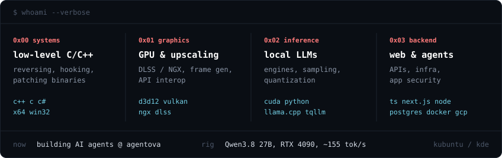

## Open source

**Contributions**

| Project | What I did |
| --- | --- |
| [turbo-tan/tqllm](https://github.com/turbo-tan/tqllm) ★131 · LLM inference engine | Token trees for sampled requests on CUDA: **146 → 173 tok/s** on an RTX 4090 ([#43](https://github.com/turbo-tan/tqllm/pull/43)) · fix of a 1.6.0 sampling regression ([#42](https://github.com/turbo-tan/tqllm/pull/42)) · Windows / MSVC build restored ([#41](https://github.com/turbo-tan/tqllm/pull/41)) |
| [Supermedo/bloodborne_pc](https://github.com/Supermedo/bloodborne_pc) ★5.5k · Bloodborne native PC port | DLSS on a Direct3D 12 device inside the Vulkan renderer (shared textures and fences), so DirectX 12 NGX add-ons run in the port ([#175](https://github.com/Supermedo/bloodborne_pc/pull/175)) |
| [Skyrim SE: DynamicShaderFrameGen](https://github.com/jatelop8/DynamicShaderFrameGen) · frame generation plugin | Optional DLAA pass before DLSS-G, so DLSS-hooking add-ons can run after upscaling ([#3](https://github.com/jatelop8/DynamicShaderFrameGen/pull/3)) |

**My projects**

| Project | |
| --- | --- |
| [dlss5native](https://github.com/AlexandreL04/dlss5native) | DLSS 5 in any DirectX 12 game that already ships DLSS. Runs right after the game's own DLSS by hooking the NGX core. C++ |
| [tq4enc](https://github.com/AlexandreL04/tq4enc) | Open TQ4 quantizer for tqLLM: plain, imatrix-weighted or engine-calibrated rounding, with LDLQ error feedback. Python |
